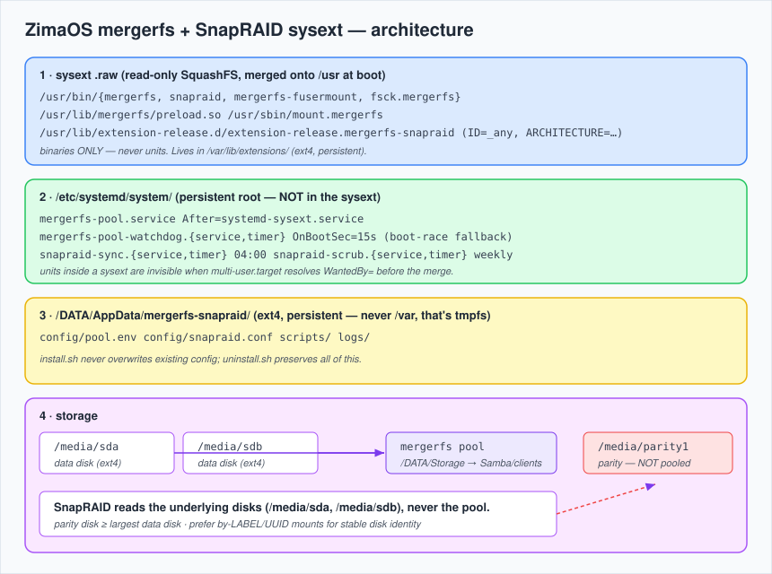
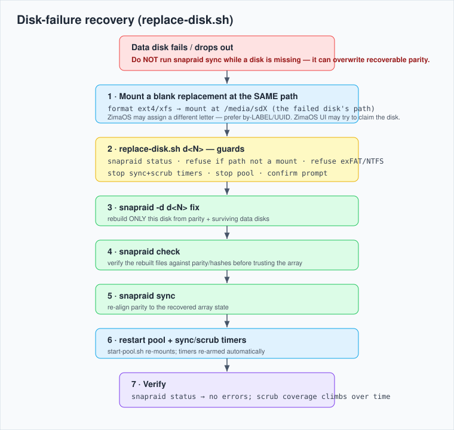

# zimaos-mergerfs-snapraid-sysext

Native **mergerfs** (union pool) + **SnapRAID** (snapshot parity) for ZimaOS,
packaged as a `systemd-sysext` module — same delivery mechanism as the ZimaOS
`cron` and `tailscale` sysext modules. No Docker for the storage layer, no
writes to the read-only ZimaOS root, survives reboots and (with `ID=_any`)
minor ZimaOS updates.

> **Status: amd64 fully hardware-validated on a ZimaCube Pro (2026-05-30).** Build →
> merge → pool → sync/scrub → file recovery → mass-delete guard → `replace-disk.sh`
> → **cold-boot boot-race (pool auto-mounted, timers armed)** → uninstall (data
> preserved). Full log: [docs/TESTLOG.md](docs/TESTLOG.md).
>
> Re-run on a **ZimaBoard 2** (ZimaOS 1.8.0) with v1.2.0 on 2026-10-18, using RAM-backed stand-in disks:
> install from the release, pool, sync, check, delete guard and `replace-disk.sh` all passed. A reboot there on
> 2026-10-19 brought the module, the units and the pool back by themselves (11 of 11 checks, see `docs/TESTLOG.md`).
>
> **Caveats:** the array test was **single-spindle** (one disk partitioned into
> data+parity) — it validates every software path but not real multi-disk fault
> tolerance. **arm64 is built but not hardware-tested.** Use ext4/xfs on separate
> physical disks (parity ≥ largest data) before trusting real data.
>
> **Note:** ZimaOS 1.6.1 already ships an ancient **mergerfs v1.5.4** in its base
> `/usr`; this module shadows it with **2.42.0** while merged and reverts cleanly on
> uninstall — so it also *upgrades* the built-in mergerfs.

## What it gives you

- Flexible mixed-size disk pooling (mergerfs), disks stay individually readable.
- Parity protection without traditional RAID lock-in (SnapRAID), up to 6-disk.
- Scheduled sync (daily) + scrub (weekly), with a mass-deletion guard.
- Boot-race-safe autostart (the thing the manual PoC lacked).

## Verified facts

Rows tagged **hw** were checked live on a ZimaCube Pro (v1.6.1, kernel
6.12.25, amd64) on 2026-05-30.

| Item | Value | Conf. |
|---|---|---|
| Kernel FUSE | `CONFIG_FUSE_FS=y`, `CONFIG_FUSE_PASSTHROUGH=y`, `/dev/fuse` (10,229) present | sicher (hw) |
| **SquashFS comp** | kernel has **ZLIB/LZ4/LZO**, **NOT ZSTD/XZ** → `.raw` MUST be `-comp gzip` | sicher (hw) |
| usrmerge | `/sbin→usr/sbin`, `/bin→usr/bin`, `/lib→usr/lib` (all symlinks) | sicher (hw) |
| **PATH / bin dir** | default PATH is `/usr/bin:/usr/sbin`; **`/usr/local/bin` does not exist** → binaries relocated to `/usr/bin` | sicher (hw) |
| sysext target | `/var/lib/extensions` = `nvme0n1p8[/.extensions]` ext4; 10 modules already merged (cron, tailscale, zfw…) | sicher (hw) |
| build tooling | `mksquashfs 4.6.1`, `docker 27.5.1`, `curl`, `unsquashfs` all present on host | sicher (hw) |
| mergerfs static tarball | `mergerfs-2.42.0-static-linux_{amd64,arm64}.tar.gz` exists (+ armhf/i386/riscv64) | sicher |
| mergerfs internal layout | tarball ships `usr/local/bin/{mergerfs,mergerfs-fusermount,fsck.mergerfs,mergerfs.collect-info}`, `usr/local/lib/mergerfs/preload.so`, `sbin/mount.mergerfs` → **we relocate to `/usr/bin`, `/usr/lib`, `/usr/sbin`** | sicher (hw) |
| SnapRAID | source `snapraid-15.0.tar.gz` (sha256 `ceba44e1…ce19` = release digest); pure userspace C, no kernel/daemon dep | sicher |
| Version pins | mergerfs `2.42.0` and SnapRAID `15.0` (2026-10-16; moved from 14.5 on 2026-10-17 after a host test: guard parsing, check, fix, and content files readable by 14.5 and 15.0 in both directions — `docs/TESTLOG.md`) | sicher |
| systemd ARCH token | `x86-64` (amd64), `arm64` (arm64) — used in `extension-release` | sicher |
| ZimaOS | `ID=zimaos`, `VERSION_ID=1.6.1`, ZimaCube amd64 | sicher (hw) |
| Data-disk mounts | ZimaOS automounts at `/media/sdX` (+ bind `/DATA/.media/`); current test disk `/media/sda` = `/dev/sdb` **exFAT** (1 disk only) | sicher (hw) |

## Repo layout

```
build/Dockerfile.snapraid   static snapraid build (multi-stage, scratch export)
build/build-snapraid.sh     build static snapraid per arch (buildx)
build/build-sysext.sh       assemble .raw sysext per arch + SHA256SUMS
build/Dockerfile.mergerfs-tools  one-shot runner image for the upstream mergerfs-tools
build/build-mergerfs-tools.sh    pre-build that image (auto-built on first use too)
units/                      systemd units (live in /etc, NOT in the sysext)
scripts/                    start/stop pool, snapraid sync/scrub, replace-disk,
                            pool-status (native overview), mergerfs-tool (maintenance)
                            — shipped INSIDE the sysext at /usr/lib/mergerfs-snapraid/
tests/run.sh                host-free script/unit tests (stubs, no root): sh tests/run.sh
tests/check-raw.sh          image check: gzip, extension-release, scripts present + identical
config/*.example            pool.env + snapraid.conf templates
install.sh / uninstall.sh   root installer (preserves data on uninstall)
docs/                       architecture.svg + recovery.svg (theme-neutral)
.github/workflows/build.yml CI: dual-arch build + ldd/--version smoke + release artifacts
```



## Build (on the ZimaCube, amd64; arm64 cross-built via qemu)

```sh
# one-time, only needed to cross-build arm64 on an amd64 host:
docker run --privileged --rm tonistiigi/binfmt --install all

cd build
./build-snapraid.sh amd64
./build-snapraid.sh arm64      # optional, for ZimaBoard
./build-sysext.sh   amd64
./build-sysext.sh   arm64      # optional
# -> build/out/mergerfs-snapraid_{amd64,arm64}.raw  +  build/out/SHA256SUMS
```

## Install

### From a release (no build needed)

`install.sh` does not download anything: it takes the image from `build/out/` of the
folder it sits in. So fetch the source of a release tag and put that release's image
and `SHA256SUMS` next to it (use `_arm64` instead of `_amd64` on an ARM board):

```sh
V=v1.2.0                                    # the release you want
B=https://github.com/chicohaager/zimaos-mergerfs-snapraid-sysext
curl -fsSL "$B/archive/refs/tags/$V.tar.gz" | tar xz
cd "zimaos-mergerfs-snapraid-sysext-${V#v}"
mkdir -p build/out
curl -fsSL -o build/out/mergerfs-snapraid_amd64.raw "$B/releases/download/$V/mergerfs-snapraid_amd64.raw"
curl -fsSL -o build/out/SHA256SUMS                  "$B/releases/download/$V/SHA256SUMS"
sudo ./install.sh        # verifies the checksum, then continues as below
```

Download `SHA256SUMS` too: without it `install.sh` only warns and skips the check.

### Install, configure, start (release or source build)

```sh
sudo ./install.sh                       # config + logs in /DATA/AppData/mergerfs-snapraid
# or keep them elsewhere, e.g. on a SATA SSD that ZimaOS mounts late:
#   sudo ./install.sh --app-dir /media/SSD-Storage/AppData/mergerfs-snapraid
# then edit (paths below assume the default app dir):
#   /DATA/AppData/mergerfs-snapraid/config/pool.env       (BRANCHES = data disks, NOT parity)
#   /DATA/AppData/mergerfs-snapraid/config/snapraid.conf  (parity/content/data = underlying disks)
sudo systemctl start mergerfs-pool.service
sudo /DATA/AppData/mergerfs-snapraid/scripts/snapraid-sync.sh   # first parity build
```

The sync/scrub timers are **active right after install** (no reboot needed; older
installers only *enabled* them, so they stayed inactive until the next boot). Until you
edit them, the pool, sync and scrub **refuse** to act on a config that is still
byte-identical to the shipped example (`REFUSE: … is the unedited example`) — the
examples name `/media/sda` + `/media/sdb`, which are real disks on many boxes.

**Upgrading an install whose units you edited by hand** (e.g. AppData moved to an SSD
and the path written into `mergerfs-pool.service`): just re-run `sudo ./install.sh`.
Without `/etc/default/mergerfs-snapraid` it takes `APP_DIR` from the `…/scripts/*.sh`
and `…/config/snapraid.conf` paths in your installed units, keeps your config there,
and saves the old unit files to `$APP_DIR/units-backup-<time>/`. It refuses (and asks
for `--app-dir`) if the units name different paths, or if that path is not present
right now — mount the disk first, otherwise `config/` would be created on the bare
mountpoint directory.

### Settings — `/etc/default/mergerfs-snapraid`

`install.sh` only rewrites the `APP_DIR=` line; every other line there is yours and
survives re-installs.

| Setting | Default | Effect |
|---|---|---|
| `APP_DIR` | `/DATA/AppData/mergerfs-snapraid` | where `config/` and `logs/` live (set via `install.sh --app-dir`) |
| `CONFIG_WAIT` | `300` | boot: seconds the pool waits for `$APP_DIR/config/pool.env` |
| `DELETE_THRESHOLD` | `200` | sync aborts when `snapraid diff` reports more removed files |
| `NOTIFY_CMD` | — | shell command run when the pool, sync or scrub fails; gets `$ALERT_UNIT`, `$ALERT_FILE` |

**Intended mass deletion** (forum #20: 8000 files cleaned up, every nightly sync then
aborted): the sync log and the journal print the exact one-time release, e.g.
`sudo $APP_DIR/scripts/snapraid-sync.sh --allow-deletes 8000` — it syncs only if the
real count is ≤ that number, for that one run. Check the `remove` lines in the log first.

**Failure alerts:** pool, sync and scrub carry `OnFailure=mergerfs-snapraid-alert@%n.service`.
Every failure writes `$APP_DIR/logs/ALERT-<unit>-<time>.txt` (visible in the ZimaOS
Files app) with the unit's last journal lines, then runs `NOTIFY_CMD` if set, e.g.
`NOTIFY_CMD='curl -s -d "$ALERT_UNIT failed" https://ntfy.sh/<your-topic>'`.
*Verified on .143 (2026-10-17):* a refused sync produced the ALERT file within 1 s.

## Design notes / decisions

- **sysext merges only `/usr`** (+`/opt`). `build-sysext.sh` relocates the tarball's
  `/sbin/mount.mergerfs` to `usr/sbin/` so it lands at `/sbin` via the
  `/sbin -> /usr/sbin` usrmerge symlink. *Verify usrmerge once:* `ls -ld /sbin`.
  If `/sbin` is NOT a symlink to `/usr/sbin`, `mount.mergerfs` won't be on PATH —
  harmless, since the pool service calls the `mergerfs` binary directly. **wahrscheinlich**
- **Units live in `/etc/systemd/system/`, not in the sysext.** This is the lesson
  from the tailscale/cron modules: a unit *inside* the sysext isn't visible when
  `multi-user.target` resolves `WantedBy=` before `systemd-sysext.service` merges.
  Here only binaries + scripts are in the sysext (no units); the pool service is ordered
  `After=systemd-sysext.service` and a 60s watchdog timer is a fallback. **sicher** (reasoning)
- **`extension-release` uses `ID=_any` + `ARCHITECTURE`** so the image survives
  ZimaOS minor updates without re-install, while refusing a wrong-arch merge.
  The systemd `ARCHITECTURE` token is **`x86-64`** for amd64 and **`arm64`** for
  arm64 (these are systemd's own identifiers, not the dpkg `amd64`/`arm64` — note
  amd64 differs). `build-sysext.sh` maps them. **sicher**
  Alternative (stricter, re-install per update like the tailscale module):
  set `ID=zimaos` + `VERSION_ID=1.6.1` in `build-sysext.sh`. **wahrscheinlich**
- **Two independent boot races (root cause of the `watchdog failed` report):**
  - **(1) sysext-merge race — this is what fails the watchdog.** The ZimaOS base
    ships an *ancient* mergerfs **v1.5.4** at `/usr/bin/mergerfs`, so gating on that
    path (the old `ConditionPathExists=/usr/bin/mergerfs` + watchdog `[ -x ]`) is
    useless: it is satisfied **before** the merge by the stale base binary, which
    then rejects modern `-o` options and fails `mergerfs-pool.service` → the watchdog
    that re-`start`s it also fails. **Fix:** gate on **`/usr/bin/snapraid`**, which is
    provided *only* by this sysext, so its presence truly means "merge done"; the
    watchdog waits up to 60s for it and never false-fails. `start-pool.sh` carries the
    same guard for manual runs. *Verified on .143 (2026-06-05):* with the sysext
    unmerged, `/usr/bin/mergerfs`=v1.5.4 exists while `/usr/bin/snapraid` is absent.
  - **(2) automount race — empty/degraded pool.** The ZimaOS storage daemon mounts
    the data disks at `/media/sdX` late, with **no** unit to order against. mergerfs
    2.42 does *not* fail on an unmounted/missing branch (verified: exit 0) — it mounts
    an **empty** pool and shadows the disk when it appears later ("not recognized").
    **Fix:** `start-pool.sh` waits (default `BRANCH_WAIT=90`s) for every branch to be a
    mountpoint, non-empty, or marked with `.mergerfs.branch`, and **refuses** (exit 1)
    both an absent branch and one that is still an empty, unmounted folder after the
    wait (before 2026-10-17 it said "proceeding anyway" and mounted over it;
    `ALLOW_EMPTY_BRANCH=1` in `pool.env` restores that). Second layer:
    `branches-mount-timeout=30,branches-mount-timeout-fail=true` — mergerfs itself
    exits instead of mounting. *Verified on .143 (ZimaOS 1.8.0, 2026-10-17):* without
    `-fail` an unmounted branch still mounted (rc=0, "Continuing to mount mergerfs
    despite…"); with it rc=1, nothing mounted. mergerfs counts a branch as mounted
    when it is on a different filesystem than the pool mountpoint (`st_dev`, see
    `src/fs_wait_for_mount.cpp`) — so a branch that is a **plain folder** on the same
    filesystem (e.g. `/DATA/foo`) needs `touch /DATA/foo/.mergerfs.branch`, and
    `start-pool.sh` prints a NOTE naming such branches. Full cold-boot test pending.
- **Scripts live in the sysext, config wherever you want it (forum #21).** The units
  exec `/usr/lib/mergerfs-snapraid/*.sh` from the read-only image, never from AppData.
  Before, they exec'd `/DATA/AppData/.../scripts/start-pool.sh`; with AppData moved to
  a SATA SSD that mounts a few seconds after the sysext merge, the pool failed with
  `203/EXEC` ("Unable to locate executable") and the watchdog's single retry failed
  too. The config location is recorded once in `/etc/default/mergerfs-snapraid`
  (`APP_DIR=...`, persistent `/etc`); `start-pool.sh` waits up to `CONFIG_WAIT`
  (default 300 s, settable in that file) for `$APP_DIR/config/pool.env`, and
  sync/scrub refuse (exit 1) rather than create `logs/` on an unmounted disk's
  mountpoint. `$APP_DIR/scripts/` keeps symlinks, so the documented commands still
  work; hand-edited copies from older installs are moved to `scripts/.replaced-<date>/`.
  The units also carry `RequiresMountsFor=/DATA` (ZimaOS KB: `/DATA` is a late bind
  mount not ordered behind `local-fs.target`). Stub-tested + image-checked;
  **cold boot with AppData on a second disk not yet hardware-tested.**
- **SnapRAID disk identity:** SnapRAID keys disks by path; ZimaOS assigns
  `/media/sdX` by detection order, so a replacement can land on a different
  letter. Prefer by-LABEL/UUID mounts; `replace-disk.sh` reconciles the path and
  refuses to proceed on a mismatch. **Risiko — handled, not eliminated.**
- **State under `/DATA/AppData`** (ext4 persistent); never `/var` (tmpfs).
- **SnapRAID is static** (`LDFLAGS=-static`) — the PoC's snapraid was dynamically
  linked against Debian glibc and only worked by luck on the test board.

## ⚠ Filesystem requirement

Data and parity disks should be **ext4 or xfs**. exFAT/NTFS lack POSIX
permissions, xattrs and hardlinks → mergerfs loses metadata and SnapRAID
move-detection / `pool` view degrade. The current test disks are
**exFAT** — reformat (destructive) before using for a real array. SnapRAID also
needs a dedicated **parity disk >= the largest data disk**.

## Disk-failure recovery

When a data disk fails, recover with `replace-disk.sh` — **never** run `snapraid
sync` while a disk is missing (it can overwrite still-recoverable parity).

```sh
# 1. Format the replacement ext4/xfs and mount it at the SAME path the failed
#    disk used (the `data d<N> <path>` line in snapraid.conf). ZimaOS may assign
#    a different /media/sdX letter — verify the mount; by-LABEL/UUID is safer.
# 2. Run the guided helper (it refuses a non-mount path or an exFAT/NTFS disk):
sudo /DATA/AppData/mergerfs-snapraid/scripts/replace-disk.sh d1
```

It runs `snapraid status`, stops the timers + pool, prompts for confirmation,
then `fix -d d1` → `check` → `sync`, and finally restarts the pool + timers.

It refuses to start while a sync/scrub is running, and writes
`$APP_DIR/RECOVERY-IN-PROGRESS` before it stops anything. While that file exists,
scheduled sync and scrub **refuse** (and trigger the failure alert) — also after a
reboot, when the enabled timers come back. Only a complete `fix → check → sync`
removes it and re-arms the timers. **If the recovery fails**, the pool is restarted
but the timers stay stopped and the marker stays, so no nightly sync can overwrite
the parity a retry needs; re-run `replace-disk.sh d1` after fixing the cause. (Before
2026-10-17 a failed recovery re-armed the timers.)
Full flow: `docs/recovery.svg`.



## Pool maintenance (mergerfs-tools)

Two helpers wrap the upstream [trapexit/mergerfs-tools](https://github.com/trapexit/mergerfs-tools)
so they're usable on ZimaOS *and* safe alongside SnapRAID:

- **`pool-status.sh`** — native (no Docker, no Python). Per-branch fullness + the
  spread between fullest/emptiest disk, so you know whether a balance is even worth it.
- **`mergerfs-tool.sh`** — runs the Python tools in a throwaway container
  (`build/Dockerfile.mergerfs-tools`, pinned to an upstream commit; auto-built on
  first use). ZimaOS has no native Python, so the storage *runtime* stays native and
  only this occasional maintenance step touches Docker.

```sh
T=/DATA/AppData/mergerfs-snapraid/scripts/mergerfs-tool.sh
sudo "$T" status                          # native overview — start here
sudo "$T" --quiesce balance               # equalize disk fullness (see SnapRAID note)
sudo "$T" consolidate /DATA/Storage/Movies/SomeShow   # dry-run (print only)
sudo "$T" --quiesce consolidate -e /DATA/Storage/Movies/SomeShow  # actually move
sudo "$T" dedup /DATA/Storage             # dry-run; add -e (+ --quiesce) to remove
sudo "$T" fsck /DATA/Storage              # audit perms/ownership (read-only)
sudo "$T" ctl -m /DATA/Storage list values   # runtime branch/option introspection
```

> **🔴 SnapRAID safety.** `balance`, `consolidate`, `dedup`, `dup` physically *move*
> files between disks. To SnapRAID a moved file looks **removed** from one disk and
> **added** to another, so **parity is stale until the next `snapraid sync`**. Always
> use **`--quiesce`** for data-moving runs: it stops the sync/scrub timers, runs the
> tool, then re-syncs parity (with the mass-deletion guard's count relaxed, since the
> "removals" are expected here) and re-arms the timers. `balance` has **no dry-run**
> and refuses to run without `--quiesce` (or `--yes` if you'll sync manually). The
> print-only tools (`consolidate`/`dedup`/`dup` without `-e`) are safe to run anytime.

> **⚠ Hardlinks + directory mtimes.** Upstream moves files with
> `rsync -avlHAXWE --remove-source-files`, one file at a time. At the pinned commit
> two upstream issues are still open: hardlinked files are split into separate copies
> (PR [#153](https://github.com/trapexit/mergerfs-tools/pull/153)) and each move resets
> the source directory's mtime (issue [#157](https://github.com/trapexit/mergerfs-tools/issues/157)).
> `mergerfs-tool.sh` prints this warning before a data-moving `balance`/`consolidate`;
> check `find <pool> -type f -links +1` first. Upstream removed `mergerfs.fsck` after
> the pin (commit `940f2d0`, 2026-10-01) — when bumping `MFT_SHA`, drop it from the
> Dockerfile and use the native `fsck.mergerfs` shipped in this sysext.

> **Status: hardware-validated on amd64 (2026-06-04, ZimaCube Pro, v1.6.1).** Full
> `--quiesce balance` flow tested end-to-end on the single-spindle SR test rig: 14 GB
> unbalanced (19%/1%) → balance moved 13 files → 11%/9%, post-balance `snapraid sync`
> survived the moved-as-deleted guard, `snapraid check` = "Everything OK", and the
> file manifest was byte-identical before/after. **Same caveats as the storage core:**
> single-spindle (validates every code path, not real multi-disk fault tolerance), and
> **arm64 is unbuilt/untested** for the runner. Dry-run first on real data.

## Troubleshooting

- **`systemd-sysext status` doesn't list the module / "incompatible image":**
  the `ARCHITECTURE` token may not match this systemd build. Check the merge log
  (`journalctl -u systemd-sysext`); as a quick test, rebuild with the
  `ARCHITECTURE=` line removed from `build-sysext.sh` (install.sh already selects
  the correct arch by `uname -m`).
- **Pool not mounted after reboot:** check `systemctl status mergerfs-pool.service`
  and that the watchdog timer fired (`systemctl status mergerfs-pool-watchdog.timer`).
  "branch … is empty and not a mountpoint … refusing" means a disk was not mounted in
  time: raise `BRANCH_WAIT`, or mark an intentionally empty folder with
  `.mergerfs.branch`. "N of M branches were not mounted … Exiting" comes from
  `branches-mount-timeout-fail` — same causes.
- **New files fail with "No space left on device" although the disks have room:** the example `OPTS` carry
  `minfreespace=20G`, i.e. mergerfs keeps 20 GB free on every branch and refuses to place a file on one that has
  less. On disks (or test volumes) smaller than that, lower the value in `pool.env` (for example `minfreespace=1G`)
  and restart the pool. *Seen on a ZimaBoard 2 with 128 MiB stand-in disks, 2026-10-18; the run used `16M`.*
- **sync/scrub unit `failed`:** the scripts now exit with SnapRAID's own status (before
  2026-10-17 a failed sync still exited 0). Read the newest log in `$APP_DIR/logs/`.
- **`install.sh`: "/usr/bin/mergerfs reports 'mergerfs v1.5.4', expected v2.42.0":** the
  extension did not merge, and the ZimaOS base mergerfs answered instead. Check
  `systemd-sysext status` and `journalctl -u systemd-sysext` (gzip squashfs, file name
  `mergerfs-snapraid.raw`). The image records its versions in
  `/usr/lib/mergerfs-snapraid/VERSIONS`; `tests/check-versions.sh` (CI) keeps every pin
  in the repo consistent and warns when upstream has a newer release.
- **`mergerfs-pool.service` fails with `203/EXEC` / "Unable to locate executable":**
  the units still point at the old AppData script paths — re-run `sudo ./install.sh`
  with a current `.raw` (install refuses an image without `/usr/lib/mergerfs-snapraid/`).
- **Pool waits / "…pool.env not found after 300s":** the disk holding `APP_DIR` (see
  `/etc/default/mergerfs-snapraid`) did not mount in time; raise `CONFIG_WAIT=` there.
  If the message names the *default* `/DATA/AppData/mergerfs-snapraid` although you installed with
  `--app-dir`, `/etc/default/mergerfs-snapraid` is missing (the scripts then fall back to the default path):
  re-run `sudo ./install.sh --app-dir <your dir>`; it keeps your config. That file sits in the persistent
  `/etc` overlay next to the units and survived a reboot and several `systemd-sysext refresh` runs
  (measured 2026-10-18); whether it survives a ZimaOS A/B update is not measured.
- **`allow_other` rejected:** only relevant for non-root access; needs
  `user_allow_other` in `/etc/fuse.conf`. Running via the root systemd unit, it's fine.

## Roadmap

- Phase 4: evaluate SnapRAID Daemon v1.9 (web UI) — sysext vs container. **unsicher**
- Phase 5: Mod-Store PR for 1-click install.

## License

The scripts, units, build files and documentation of this repository are licensed under either of

- Apache License, Version 2.0 ([LICENSE-APACHE](LICENSE-APACHE))
- MIT license ([LICENSE-MIT](LICENSE-MIT))

at your option. Unless you explicitly state otherwise, any contribution intentionally submitted for
inclusion in this work shall be dual licensed as above, without any additional terms or conditions.

### Third-party software

The released `.raw` image contains two programs that are **not** covered by the licenses above. The versions
and download URLs are the ones the build scripts use; this section states what the upstream projects say and
is not legal advice.

| Program | Version | License (upstream file) | Source |
|---|---|---|---|
| [mergerfs](https://github.com/trapexit/mergerfs) | 2.42.0 (binaries from the official static release tarball, only relocated to `/usr`; SHA256 pinned in `build/build-sysext.sh`) | ISC (`LICENSE`) | `https://github.com/trapexit/mergerfs/releases/download/2.42.0/` |
| [SnapRAID](https://www.snapraid.it) | 15.0 (built statically from the release tarball, SHA256 pinned in `build/Dockerfile.snapraid`) | GPL-3.0-or-later (`COPYING`: "The SnapRAID project as a whole … is provided under the GPL-3.0-or-later License") | `https://github.com/amadvance/snapraid/releases/download/v15.0/snapraid-15.0.tar.gz` |

The SnapRAID binary in the image is built from exactly that source tarball with `build/Dockerfile.snapraid`
(no patches), so the corresponding source and the build recipe are in this repository's `build/` folder and the
upstream release. The optional maintenance runner (`mergerfs-tool.sh`) fetches
[trapexit/mergerfs-tools](https://github.com/trapexit/mergerfs-tools) (ISC) at a pinned commit when it builds its
container on your machine; it is not part of the image.

---

## ☕ Support

If this project saves you time, you can buy me a coffee — it keeps the side projects going.

<!-- bmc-button -->
[](https://buymeacoffee.com/holgi18114)

… or scan the code:

<a href="https://buymeacoffee.com/holgi18114"></a>
